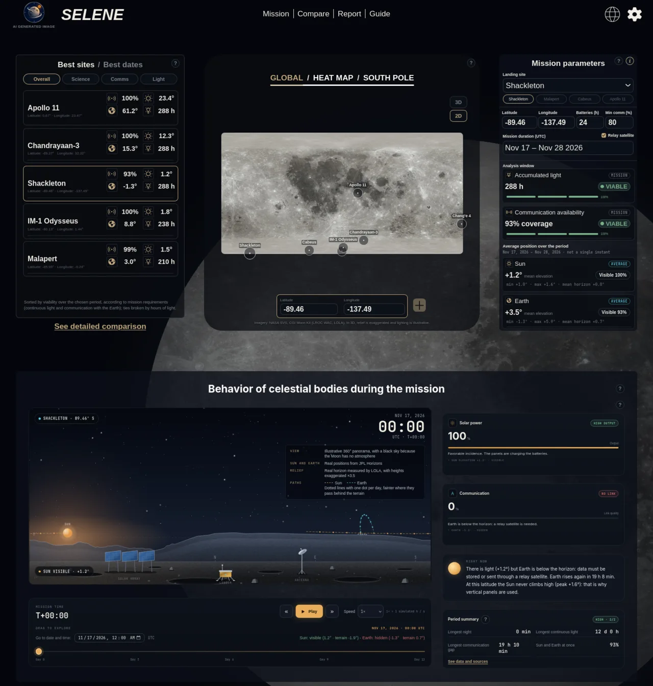
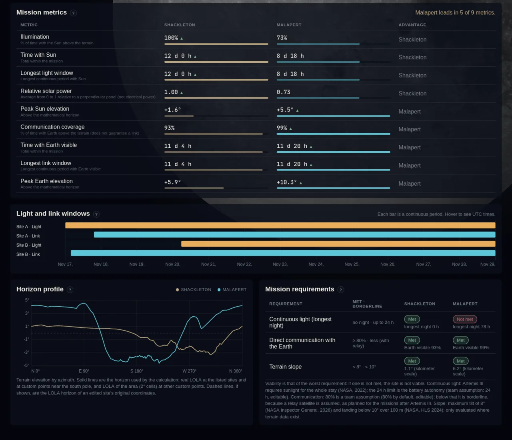

# SELENE · Lunar landing site explorer

[](https://github.com/lucioooofacc/Selene-SpaceApps/actions/workflows/ci.yml)
[](https://selene-space-apps.vercel.app)
[](https://www.spaceappschallenge.org/)

[Español](README.md) · **English**

SELENE is a web tool to **compare lunar landing sites and dates**, focused on the Moon's south pole. For each place and period it shows where the Sun and the Earth are relative to the real terrain horizon, and uses that to answer two questions every mission has to face: **will there be light for the solar panels?** and **will we be able to talk directly to Earth?**

It was built by team **Hubble27** at the **NASA Space Apps Challenge 2026** (Salto/Paysandú local event, Uruguay, November 14–15, 2026) for the *Create a Lunar Mission Explorer* challenge.

**👉 Try it at https://selene-space-apps.vercel.app** (designed for desktop, 1200 px wide or more). The interface is available in Spanish and English.



## The problem

At the lunar south pole the Sun barely clears the horizon and the Earth rises and sets over the month. A few kilometers or a few days can completely change how much power a mission generates and when it can communicate. The NASA tools that hold this data (JPL Horizons, Quickmap, Moon Trek) are built for detailed analysis and are hard to use for quick scenario comparison. The challenge asked for an intuitive tool for mission planners, educators and the public ([full challenge statement](desafio.md)).

## What it does

- **Site and date ranking.** Ranks sites by feasibility for the chosen period, with Overall, Science, Comms and Light categories, and suggests the best dates for a site.
- **Curated sites and custom points.** Shackleton, Malapert, Cabeus, IM-1 Odysseus, Chandrayaan-3, Chang'e 4 and Apollo 11, each with the source of its coordinates. You can also pick any point on the map or type a latitude and longitude.
- **3D and 2D Moon with a heat map.** Layers for sunlight, Earth visibility, both at once, feasibility, night and elevation (LOLA).
- **Horizon panorama.** A 360° view with the terrain measured by LOLA and the paths of the Sun and the Earth, plus a timeline you can play or scrub.
- **Power and communication metrics.** Hours of sunlight, link coverage, longest night, communication outages, and sunrises and sunsets computed to within 5 seconds.
- **Feasibility with editable assumptions.** Battery autonomy, minimum communication and whether a relay satellite is available, with requirements based on NASA documents for Artemis.
- **Side-by-side comparison** of two sites: distance, metrics, light and link windows, horizon profile and requirements.
- **Mission report** to read or print.
- **Accessible.** Spanish and English, colorblind-friendly palette, high contrast, reduced motion, keyboard controls and a guided tour. Every selection is kept in the URL so it can be shared.



## NASA data

| Source | What it is used for |
| --- | --- |
| [NASA/JPL Horizons](https://ssd.jpl.nasa.gov/horizons/) | Azimuth, elevation and apparent radius of the Sun and the Earth as seen from each site, hourly, from November 2026 to December 2027 (DE441). |
| [LRO LOLA, NASA PDS](https://doi.org/10.17189/1520642) | Elevation models (`LDEM_60S_240M`, `LDEM_128`, `LDEM_16`) to compute each site's real horizon and the heat map. |
| [NASA SVS, CGI Moon Kit](https://svs.gsfc.nasa.gov/4720/) | Moon imagery (LROC WAC mosaic and LOLA elevation) for the 2D and 3D views. |
| NSSDCA, NTRS, PGDA, USGS, CNSA | Landing site coordinates, with each site's source listed in the app's "Data and sources" panel. |

The project documentation is written in Spanish. Details on each source, its version and how to download it are in [`docs/DATA_SOURCES.md`](docs/DATA_SOURCES.md). Models, units and conventions are in [`docs/SCIENCE.md`](docs/SCIENCE.md), and the checks against NASA data in [`docs/VALIDACION.md`](docs/VALIDACION.md).

## Known limitations

- It is a **conceptual design** for comparing scenarios, not a precision engineering tool.
- The Horizons ephemerides cover November 2026 to December 2027. Outside that range the app falls back to an approximate model and says so on screen.
- For custom points the horizon is computed from lower-resolution LOLA data and is flagged as approximate. Every approximate or simulated value is marked in the interface.
- The feasibility thresholds combine requirements published by NASA with editable team assumptions.
- The site is designed for desktop and is not responsive.

## How it is built

Vite and plain JavaScript (ES modules), no framework, with [three.js](https://threejs.org/) for the 3D Moon. Astronomical calculations live in `web/src/lib/`, and the interface in `web/src/ui/` only displays them. Ephemerides and LOLA horizons are processed ahead of time and published as static files, so the site does not depend on any server. More in [`docs/ARCHITECTURE.md`](docs/ARCHITECTURE.md).

### Run it locally

Requires Node.js 20.19 or newer (CI uses Node 22).

```bash
cd web
npm install
npm run dev      # local server at http://localhost:5173
npm test         # Node.js native tests
npm run build    # production build in web/dist
```

The tests cover the engine's mathematical invariants and, in `web/tests/validacion/`, consistency with the versioned NASA data (JPL Horizons ephemerides and LOLA products), which keep their provenance. Some validations need the full LOLA rasters and are skipped if they are not downloaded.

## Submitted version

The version submitted to Space Apps on 2026-11-15 is marked with the tag [`entrega-2026-11-15`](https://github.com/lucioooofacc/Selene-SpaceApps/tree/entrega-2026-11-15). Later changes to `main` only touch the repository documentation.

## Team Hubble27

| Area | Members |
| --- | --- |
| Web development | Facu, Alfonso and Lucio (with contributions from the whole team) |
| Astronomy and data | Teo, Facu and Lucio |
| Writing | Alfonso and Cata |
| Translation ES ↔ EN | Lucio and Cata |
| Video script | Teo and Martín |
| Video editing | Lucio and Facu |

---

SELENE is an independent project built for the NASA Space Apps Challenge. It is not an official NASA product and is not endorsed by NASA.
