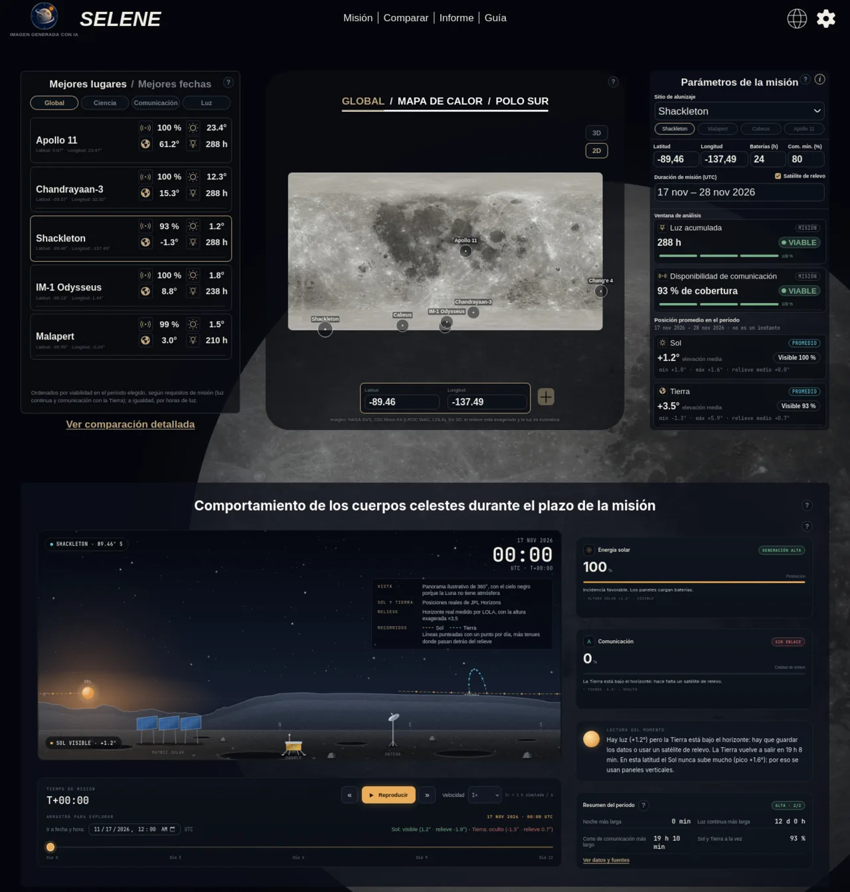
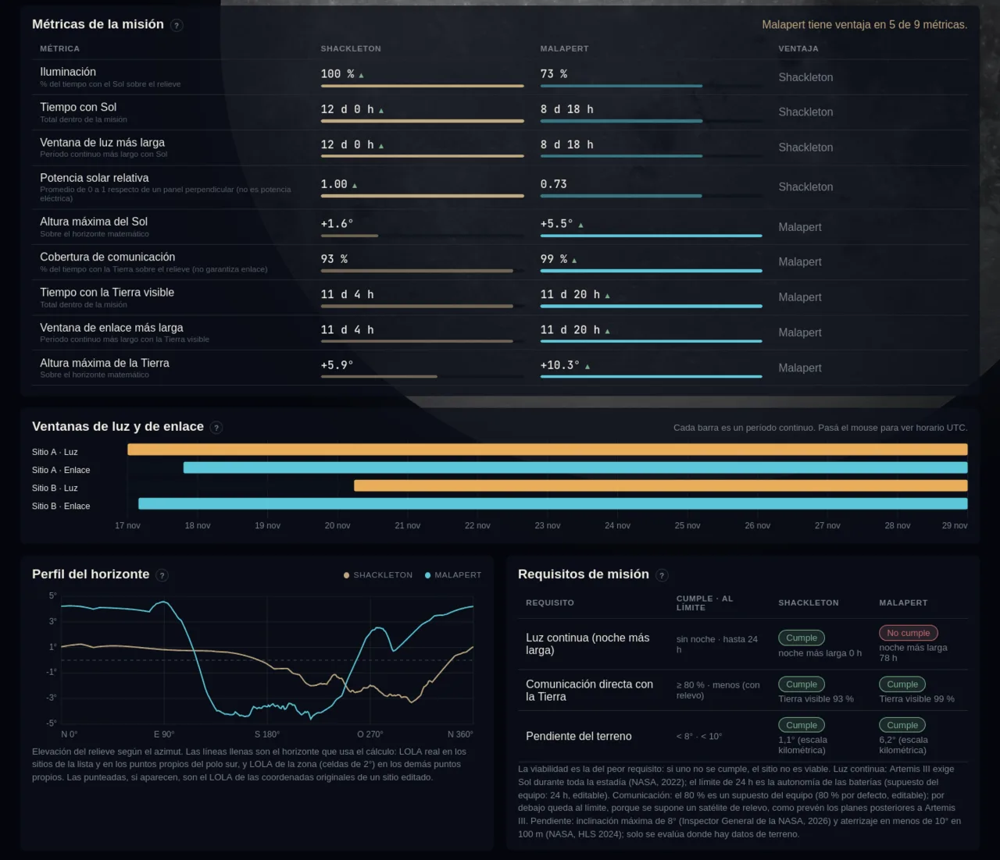

# SELENE · Explorador de sitios de alunizaje

[](https://github.com/lucioooofacc/Selene-SpaceApps/actions/workflows/ci.yml)
[](https://selene-space-apps.vercel.app)
[](https://www.spaceappschallenge.org/)

**Español** · [English](README.en.md)

SELENE es una herramienta web para **comparar sitios y fechas de alunizaje**, con foco en el polo sur de la Luna. Para cada lugar y período muestra dónde están el Sol y la Tierra respecto del horizonte real del terreno, y con eso responde dos preguntas de cualquier misión: **¿va a haber luz para los paneles solares?** y **¿se va a poder hablar directamente con la Tierra?**

La hizo el equipo **Hubble27** en el **NASA Space Apps Challenge 2026** (sede Salto/Paysandú, Uruguay, 14 y 15 de noviembre de 2026), para el desafío *Crea un explorador de misiones lunares*.

**👉 Probala en https://selene-space-apps.vercel.app** (pensada para escritorio, desde 1200 px de ancho).



## El problema

En el polo sur lunar el Sol apenas asoma sobre el horizonte y la Tierra sube y baja durante el mes. Unos pocos kilómetros o unos días de diferencia cambian por completo cuánta energía genera una misión y cuándo puede comunicarse. Las herramientas de la NASA que tienen estos datos (JPL Horizons, Quickmap, Moon Trek) están hechas para análisis detallado y cuesta usarlas para comparar escenarios rápido. El desafío pedía una herramienta intuitiva para planificadores de misiones, docentes y público general ([enunciado completo](desafio.md)).

## Qué hace

- **Ranking de sitios y de fechas.** Ordena los sitios por viabilidad para el período elegido, con categorías Global, Ciencia, Comunicación y Luz, y sugiere las mejores fechas para un sitio.
- **Sitios curados y puntos propios.** Shackleton, Malapert, Cabeus, IM-1 Odysseus, Chandrayaan-3, Chang'e 4 y Apollo 11, con la fuente de cada coordenada. También se puede elegir cualquier punto en el mapa o escribir latitud y longitud.
- **Luna en 3D y 2D con mapa de calor.** Capas de luz solar, visibilidad de la Tierra, ambas a la vez, viabilidad, noche y elevación (LOLA).
- **Panorama del horizonte.** Vista de 360° con el relieve medido por LOLA y los recorridos del Sol y la Tierra, con una línea de tiempo que se puede reproducir o arrastrar.
- **Métricas de energía y comunicación.** Horas de luz, cobertura de enlace, noche más larga, cortes de comunicación y amaneceres y ocasos calculados con una tolerancia de 5 segundos.
- **Viabilidad con supuestos editables.** Autonomía de las baterías, comunicación mínima y si hay satélite de relevo, con requisitos basados en documentos de la NASA para Artemis.
- **Comparación lado a lado** de dos sitios: distancia, métricas, ventanas de luz y enlace, perfil del horizonte y requisitos.
- **Informe** de la misión para leer o imprimir.
- **Accesible.** Español e inglés, paleta para daltonismo, alto contraste, menos movimiento, controles con teclado y un recorrido guiado. Cada selección queda en la URL para compartirla.



## Datos de la NASA

| Fuente | Para qué se usa |
| --- | --- |
| [NASA/JPL Horizons](https://ssd.jpl.nasa.gov/horizons/) | Azimut, elevación y radio aparente del Sol y la Tierra vistos desde cada sitio, hora por hora, de noviembre de 2026 a diciembre de 2027 (DE441). |
| [LRO LOLA, NASA PDS](https://doi.org/10.17189/1520642) | Modelos de elevación (`LDEM_60S_240M`, `LDEM_128`, `LDEM_16`) para calcular el horizonte real de cada sitio y el mapa de calor. |
| [NASA SVS, CGI Moon Kit](https://svs.gsfc.nasa.gov/4720/) | Imágenes de la Luna (mosaico LROC WAC y elevación LOLA) para las vistas 2D y 3D. |
| NSSDCA, NTRS, PGDA, USGS, CNSA | Coordenadas de los sitios de alunizaje, con la fuente de cada uno en el panel "Datos y fuentes" de la app. |

El detalle de cada fuente, su versión y cómo se descarga está en [`docs/DATA_SOURCES.md`](docs/DATA_SOURCES.md). Los modelos, las unidades y las convenciones están en [`docs/SCIENCE.md`](docs/SCIENCE.md), y las comprobaciones contra la NASA, en [`docs/VALIDACION.md`](docs/VALIDACION.md).

## Límites conocidos

- Es un **diseño conceptual** para comparar escenarios, no una herramienta de ingeniería de precisión.
- Las efemérides de Horizons cubren de noviembre de 2026 a diciembre de 2027. Fuera de ese rango la app usa un modelo aproximado y lo indica en pantalla.
- En los puntos propios el horizonte se calcula con LOLA a menor resolución y se marca como aproximado. Todo dato aproximado o simulado está señalado en la interfaz.
- Los umbrales de viabilidad combinan requisitos publicados por la NASA con supuestos del equipo que se pueden editar.
- La web está pensada para escritorio y no es responsive.

## Cómo está hecha

Vite y JavaScript puro (ES modules), sin framework, con [three.js](https://threejs.org/) para la Luna en 3D. Los cálculos astronómicos viven en `web/src/lib/` y la interfaz en `web/src/ui/` solo muestra. Las efemérides y los horizontes LOLA se procesan antes y se publican como archivos estáticos, así que el sitio no depende de ningún servidor. Más detalle en [`docs/ARCHITECTURE.md`](docs/ARCHITECTURE.md).

### Correrla en tu compu

Requiere Node.js 20.19 o más nuevo (la CI usa Node 22).

```bash
cd web
npm install
npm run dev      # servidor local en http://localhost:5173
npm test         # pruebas nativas de Node.js
npm run build    # versión de producción en web/dist
```

Las pruebas cubren las invariantes matemáticas del motor y, en `web/tests/validacion/`, la coherencia con los datos de la NASA versionados (efemérides de JPL Horizons y productos LOLA), que conservan su procedencia. Algunas validaciones necesitan los rasters LOLA completos y se omiten si no están descargados.

### Estructura del repositorio

| Ruta | Contenido |
| --- | --- |
| `web/` | Aplicación web (Vite + JavaScript) |
| `docs/DECISIONES.md` | Registro de decisiones técnicas, de diseño y de datos |
| `docs/ARCHITECTURE.md` | Arquitectura, contratos públicos y evolución prevista |
| `docs/SCIENCE.md` | Convenciones, modelos actuales y limitaciones científicas |
| `docs/DATA_SOURCES.md` | Catálogo y estado de fuentes científicas oficiales |
| `docs/VALIDACION.md` | Validaciones contra datos y documentos de la NASA |
| `docs/TASKS.md` | Backlog priorizado para la hackathon |
| `docs/ROADMAP.md` | Plan por etapas: estado actual, qué se está viendo y qué sigue |
| `docs/ENTREGA.md` | Checklist y textos de la entrega en Space Apps |
| `PENDIENTES.md` | Lista viva de lo que falta aplicar (se agrega y se tacha) |
| `AGENTS.md` | Reglas obligatorias para agentes de IA y para el equipo |
| `desafio.md` | Enunciado del desafío de la NASA |
| `planificacion-web/` | Instrucciones del proyecto web y diseño en Figma (`SELENE.fig`) |
| `figma/` | Íconos exportados del diseño |
| `legacy/` | Prototipo anterior (v0), solo como referencia |

### Despliegue (Vercel)

El sitio se publica en Vercel desde `main` (cada integración a `main` actualiza el sitio público). Configuración del proyecto:

| Campo | Valor |
| --- | --- |
| Root Directory | `web` |
| Framework Preset | Vite |
| Build Command | `npm run build` |
| Output Directory | `dist` |

El build es estático y multipágina (`index.html`, `compare.html` e `informe.html`, con rutas relativas). Las texturas de NASA de `web/public/nasa/` se copian tal cual; las de elevación LOLA se regeneran con `node web/scripts/build-lola-maps.mjs /ruta/a/ldem_16.tif` (ver `docs/DATA_SOURCES.md`).

## Versión entregada

La versión que se entregó a Space Apps el 15/11/2026 está marcada con el tag [`entrega-2026-11-15`](https://github.com/lucioooofacc/Selene-SpaceApps/tree/entrega-2026-11-15). Los cambios posteriores a `main` son de documentación del repositorio.

## Equipo Hubble27

| Área | Integrantes |
| --- | --- |
| Desarrollo web | Facu, Alfonso y Lucio (con aportes de todo el equipo) |
| Astronomía y datos | Teo, Facu y Lucio |
| Redacción | Alfonso y Cata |
| Traducción ES ↔ EN | Lucio y Cata |
| Guion del video | Teo y Martín |
| Edición del video | Lucio y Facu |

Perfiles en GitHub: [Facundo Duarte](https://github.com/facuduarte-dev).

## Cómo trabajamos

Cada tarea se hizo en su propia rama, con commits que explican qué cambió y por qué, y cada decisión quedó registrada en [`docs/DECISIONES.md`](docs/DECISIONES.md) junto a su solución y las alternativas descartadas. Las reglas completas están en [`AGENTS.md`](AGENTS.md); `web/src/lib/AGENTS.md` y `web/src/ui/AGENTS.md` agregan reglas específicas para el motor científico y la interfaz.

---

SELENE es un proyecto independiente hecho para el NASA Space Apps Challenge. No es un producto oficial de la NASA ni está avalado por ella.
