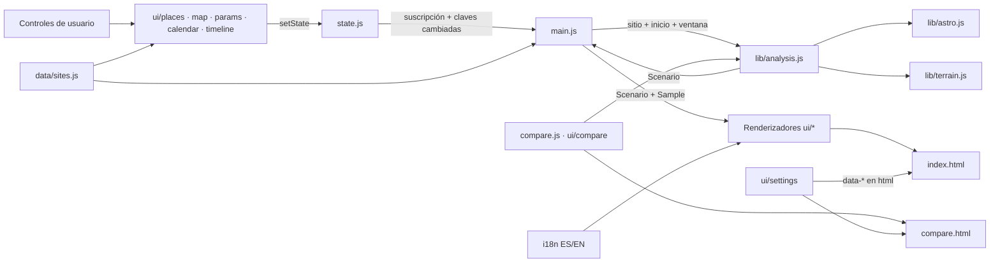
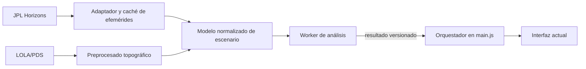

# Arquitectura de SELENE

Este documento describe la implementación actual de `web/`. El código es la fuente de verdad; el consumo de efemérides Horizons y de topografía LOLA en el análisis indicados aquí son propuestas y todavía no están implementados. El adaptador Horizons y su adquisición existen (DEC-024) y sus series alimentan `analysis.js` para los sitios curados (`lib/ephemeris.js`, DEC-033). El pipeline de datos LOLA (descarga, preparación de recortes y lectura) ya existe (DEC-025) y el horizonte LOLA de los sitios curados está precalculado (`lib/horizon-lola.js`, DEC-030); `analysis.js` lo usa para esos sitios y el sintético para el resto (DEC-032).

## Vista general

SELENE es una aplicación de dos páginas construida con Vite (multipágina) y JavaScript ES modules, sin framework: `index.html` (misión) y `compare.html` (comparación detallada entre dos sitios, UI-05). `src/main.js` coordina un estado global mínimo, el motor científico síncrono de `src/lib/` y los renderizadores imperativos de `src/ui/`.

## Responsabilidades

| Módulo | Responsabilidad actual |
| --- | --- |
| `src/main.js` | Inicializa la aplicación, mantiene la caché del escenario, decide qué recalcular y coordina renderizados completos o instantáneos. |
| `src/state.js` | Conserva el estado mutable único y notifica un `Set` de claves cambiadas a los suscriptores. |
| `src/lib/astro.js` | Modelo periódico aproximado del punto subsolar y subterrestre; transforma posiciones selenográficas en azimut/elevación local y calcula la fase terrestre. |
| `src/lib/terrain.js` | Genera un horizonte sintético determinista, estima relieve para sitios no curados y calcula la depresión geométrica por altura. |
| `src/lib/analysis.js` | Muestrea Sol/Tierra cada 10 minutos, aplica horizonte (`scenarioHorizon`: LOLA en sitios curados cubiertos, sintético en el resto, DEC-032) y la política única de visibilidad (`VISIBILITY_POLICY`, radios de Horizons, DEC-036), calcula ventanas, métricas, viabilidad y mapas de calor. |
| `src/lib/ranking.js` | Orden de "Mejores lugares" por categoría (global, interés científico, comunicación, luz) sobre resultados de `computeScenario`; sin fórmulas nuevas (DEC-029). |
| `src/data/site-traits.js` | Rasgos de interés científico por sitio con cita (pendientes de validar por astronomía); separado de `sites.js` (DEC-029). |
| `src/lib/compare.js` | Resume dos escenarios en métricas comparables (todas con "más es mejor") e indica qué sitio tiene ventaja, con tolerancias de empate. No agrega fórmulas científicas. |
| `src/lib/format.js` | Formatea ángulos, coordenadas, porcentajes, fechas UTC y duraciones para la interfaz. |
| `src/lib/horizons.js` | Adaptador puro de JPL Horizons (DEC-024): valida peticiones, arma la consulta y la clave de caché, interpreta y valida tablas `OBSERVER` y produce series normalizadas con fuente, marco, unidades y cobertura. Sin red ni DOM; sus series llegan al cálculo por `lib/ephemeris.js` (DEC-033). |
| `scripts/fetch-horizons.mjs` | Script Node, fuera del bundle: consulta la API, guarda crudo + SHA-256 + serie normalizada en una caché con manifiesto. |
| `src/lib/coordinates.js` | Referencia común de los sitios (`SITE_REFERENCE`), normalización de longitud a `[-180°, 180°)`, validación de latitud y resolución nominal de las cifras. |
| `src/lib/terrain-data.js` | Proyección estereográfica polar del producto LOLA `LDEM_60S_240M`, cobertura, interpretación de conteos `LDEC` y lectura de recortes. Sin DOM ni red; todavía no lo consume `analysis.js` (DEC-025). |
| `src/data/sites.js` | Catálogo de sitios curados en MOON_ME/DE421 con tipo de punto, procedencia, confianza y precisión (DEC-019); sin parámetros sintéticos de relieve (DEC-063). |
| `src/lib/ephemeris.js` | Series de JPL Horizons para el cálculo (DEC-033): decodifica `public/data/ephemerides/*.json`, interpola (`positionsAt`), registro en memoria con `ephemerisVersion()` y `ephemerisFor(site)`. Puro, sin red. |
| `scripts/build-ephemerides.mjs` | Arma `public/data/ephemerides/<id>.json` desde la caché validada de `fetch-horizons.mjs` (7 sitios, nov 2026 – dic 2027, paso 1 h). |
| `src/ui/ephemerides.js` | Baja en segundo plano las series de los sitios curados y las registra; `main.js`, `ui/places.js` y `compare.js` recalculan al llegar. |
| `src/ui/help.js` | Ayuda por tarjeta (botones «?») y recorrido guiado (UI-16, DEC-066). Solo muestra textos de `help.*`; no calcula. |
| `src/lib/heat-map.js` | Mapa de calor real (DEC-038): atlas de horizontes por celda, direcciones del Sol y la Tierra por instante y política única de visibilidad. Lo usan `computePolarHeatmap()` (casquete hasta −80°) y `computeGlobalHeatmap()` (toda la Luna, grilla de 2°, MAP-02, DEC-065). Puro. |
| `scripts/build-heat-atlas.mjs` | Genera `public/data/terrain/heat-atlas-96.{bin,json}` desde los rasters LOLA verificados (~6,5 min). |
| `src/lib/global-dem.js` | DEM LOLA global `LDEM_16` para el terreno de puntos fuera del polo sur (TERRAIN-04, DEC-067): decodifica, registra y muestrea. Puro. |
| `scripts/build-global-dem.mjs` | Empaqueta `LDEM_16` + `LDEC_16` en `public/data/terrain/lola-global-16ppd.{bin,json}` (DEC-067). |
| `scripts/build-site-terrain.mjs` | Genera `src/data/terrain/site-terrain.js`: terreno de los sitios curados fuera del DEM polar, desde las ventanas de `LDEM_128` (DEC-067). |
| `scripts/build-global-heat-atlas.mjs` | Genera `public/data/terrain/heat-atlas-global-2deg.{bin,json}` desde `LDEM_16` + `LDEC_16` verificados (~1 min, DEC-065). |
| `src/data/terrain/lola-ldem-16.js` | Manifiesto de `LDEM_16`/`LDEC_16` (URL, bytes, MD5, grilla) para el atlas global (DEC-065). |
| `src/lib/polar-dem.js` | DEM LOLA polar reducido (480 m hasta −80°, 960 m hasta −75°) para el horizonte de puntos propios: decodificación, registro con `polarDemVersion()` y `polarHorizonFor(site)` con caché (DEC-034). Puro. |
| `scripts/build-lola-polar-reduced.mjs` | Genera `public/data/terrain/lola-polar-<m>m.{bin,json}` desde los rasters LOLA verificados. |
| `src/lib/horizon-lola.js` | Horizonte topográfico desde el DEM LOLA: rayos sobre círculos máximos con curvatura exacta, calidad (`count = 0`, truncamiento) y `createLolaHorizon(siteId)` → `horizon(az)` con `source = "lola"`. Puro; lo usa `analysis.js` (DEC-030, DEC-032). |
| `src/data/terrain/lola-horizons.js` | Tabla generada del horizonte LOLA de los sitios cubiertos (720 azimuts), con producto, MD5, algoritmo y parámetros. |
| `scripts/build-lola-horizons.mjs` | Carga los rasters LOLA verificados, calcula la tabla de horizonte y, con `--svg`, la comparación visual con el horizonte sintético. |
| `src/data/terrain/lola-ldem-60s-240m.js` | Manifiesto del producto LOLA seleccionado: DOI, versión, URLs oficiales, bytes, MD5, grilla y proyección. Sin muestras. |
| `scripts/download-lola.mjs` | Descarga los archivos del manifiesto a `web/data/raw/` con MD5 en streaming y control de tamaño; `--verify` comprueba lo descargado. |
| `scripts/prepare-lola.mjs` | Lee DEM float32 + conteos int16 por ventanas y escribe un recorte JSON por sitio cubierto en `web/data/derived/` (no versionado). |
| `src/i18n/` | Diccionarios ES/EN, idioma persistido y traducción del DOM. |
| `src/ui/places.js` | "Mejores lugares para alunizar": ranking de sitios para la ventana elegida. |
| `src/ui/map.js` | Mapa con las pestañas GLOBAL / MAPA DE CALOR / POLO SUR, selector 3D/2D en las tres, selección de coordenadas y alta de sitios. MAPA DE CALOR muestra elevación LOLA con leyenda (DEC-026). |
| `src/ui/moon3d.js` | Luna 3D con three.js (carga diferida): textura LROC y relieve LOLA del CGI Moon Kit, render a demanda, giro con arrastre o teclado, clic → coordenadas, y marcadores HTML proyectados. |
| `src/ui/elevation.js` | Colorea en el navegador los PNG de elevación LOLA (tinte hipsométrico × sombreado) con la paleta estándar o cividis, para MAPA DE CALOR en 2D y 3D (DEC-026). Los PNG los genera `web/scripts/build-lola-maps.mjs`. |
| `src/ui/polar2d.js` | Reproyecta en el navegador el mosaico LROC equirectangular a la vista polar 2D (azimutal equidistante hasta −60°, 0° arriba). |
| `src/ui/params.js` | "Parámetros de la misión": sitio, coordenadas, duración y tarjetas de "Ventana de análisis". |
| `src/ui/calendar.js` | Selector de rango de fechas de "Duración de misión (UTC)". |
| `src/ui/panorama.js` | Panorama del sitio (ilustración del Figma) con Sol y Tierra ubicados por el modelo. La cresta es `scenario.horizon(az)` sin recortes, con 0°, puntos cardinales, exageración vertical y fuente del horizonte indicadas (UI-08). |
| `src/ui/timeline.js` | Línea de tiempo de la misión: reproducción, velocidad y deslizador. |
| `src/ui/status.js` | Tarjetas "Energía solar" y "Comunicación" y "Lectura del momento". |
| `src/ui/links.js` | Codifica y lee la selección en la URL: comparación (`compare.html?a=&b=&start=&days=`) y misión (`index.html?site=&start=&days=`, UI-12). Actualiza los enlaces entre páginas para que conserven sitio y fechas. |
| `src/ui/lola.js` | Acceso de la interfaz al horizonte LOLA de TERRAIN-02: vista previa mientras el escenario usa el sintético y uso directo cuando CORE-01 lo conecte (DEC-031). |
| `src/ui/provenance.js` | Procedencia de los sitios (metadatos de DEC-019 traducibles) y calidad de cada dato (real / aproximado / sintético) para el modal "Datos y fuentes" de la misión, la comparación y el informe (DEC-028). |
| `src/ui/settings.js` | Modal de configuración (engranaje) compartido por las dos páginas: idioma, paleta para daltonismo, alto contraste, reducir movimiento y vista del mapa; aplica `data-*` en `<html>` y recuerda las opciones en el navegador (DEC-023). |
| `src/ui/report.js` | Informe imprimible de la misión ("Informe" en el menú, o `index.html#informe`): arma el informe con el escenario vigente y abre la impresión del navegador; `styles/report.css` lo muestra solo al imprimir. |
| `src/compare.js` | Entrada de `compare.html`: lee la URL, calcula y cachea los dos escenarios y reutiliza el calendario sobre `state.js`. |
| `src/ui/compare.js` | Dibuja la comparación: encabezados con viabilidad, tabla de métricas, ventanas de luz/enlace, perfil del horizonte y criterios. |

## Estado, cálculo y renderizado

1. Un controlador de `ui/` llama a `setState(patch)`.
2. `state.js` muta solo valores distintos y entrega al suscriptor las claves cambiadas.
3. Si cambia `siteId`, `lat`, `lon`, `startMs` o `windowDays`, `main.js` invalida su clave de escenario y ejecuta `computeScenario()`.
4. El escenario precalcula la ventana seleccionada y 32 días adicionales para localizar el siguiente cambio de visibilidad.
5. `sampleAt()` interpola el instante actual. Los azimuts usan interpolación circular para no saltar entre 359° y 0°.
6. Durante la reproducción se actualizan panorama y línea de tiempo en cada cuadro; los paneles textuales se limitan aproximadamente a ocho actualizaciones por segundo.
7. Los cambios de mapa, reproducción o idioma actualizan únicamente sus consumidores principales.

`computeScenario()` es síncrono y puede ser costoso. `computePolarHeatmap()` y `computeGlobalHeatmap()` (`lib/analysis.js`) alimentan las capas calculadas de la pestaña MAPA DE CALOR (DEC-040, DEC-065) y corren en un worker cuando se puede (PERF-01, DEC-047); la capa de elevación es una imagen LOLA precomputada (DEC-026).

## Contratos públicos

Las unidades son parte del contrato. No deben cambiarse sin acuerdo del equipo y adaptación de todos los consumidores.

### `lib/astro.js`

| Firma | Entrada | Salida |
| --- | --- | --- |
| `wrap180(deg)` | grados | grados normalizados en `[-180, 180)` |
| `wrap360(deg)` | grados | grados normalizados en `[0, 360)` |
| `subSolarPoint(ms)` | milisegundos Unix UTC | `{lat, lon}` en grados selenográficos, este positivo |
| `subEarthPoint(ms)` | milisegundos Unix UTC | `{lat, lon}` en grados selenográficos, este positivo |
| `skyPosition(site, sub)` | `{lat, lon}` y punto subyacente, grados | `{elevation, azimuth}` en grados; azimut desde norte en sentido horario |
| `sunPosition(site, ms)` | sitio + milisegundos Unix UTC | posición local del Sol |
| `earthPosition(site, ms)` | sitio + milisegundos Unix UTC | posición local de la Tierra |
| `earthPhase(ms)` | milisegundos Unix UTC | fracción iluminada en `[0,1]` |

Constantes públicas: `DAY_MS`, `SYNODIC_MONTH`, `ANOMALISTIC_MONTH`, `DRACONIC_MONTH`, `ECLIPSE_YEAR`, `SUN_RADIUS` y `EARTH_RADIUS`.

### `lib/terrain.js`

| Firma | Entrada | Salida |
| --- | --- | --- |
| `estimateRelief(lat, lon)` | grados selenográficos | relieve sintético característico en grados |
| `horizonDip(elevationKm = 0)` | km sobre terreno vecino | depresión angular positiva en grados |
| `createHorizon(site, options?)` | sitio; `precompute` opcional | función `horizon(azimuthDeg) -> elevationDeg` |

### `lib/terrain-data.js`

| Firma | Entrada | Salida |
| --- | --- | --- |
| `latLonToPixel(lat, lon, grid?)` | grados (lat ≤ 0) | `{line, sample}` fraccionarios, base 0 |
| `pixelToLatLon(line, sample, grid?)` | píxel | `{lat, lon}` con lon en `[-180, 180)` |
| `nearestPixel(lat, lon, grid?)` | grados | `{line, sample}` enteros o `null` fuera de la grilla |
| `isCovered(lat, lon, grid?)` | grados | `true` si lat ≤ −60° y el píxel está en la grilla |
| `measurementFromCount(count)` | conteo LDEC | `{count, direct, confidence}`; `count = 0` ⇒ `direct: false`, `"baja"` |
| `validateTile(tile)` | recorte de `prepare-lola.mjs` | lista de errores (vacía si es válido) |
| `tileValueAt(tile, lat, lon, grid?)` | recorte y punto | `{heightM, count, direct, confidence, line, sample}` o `null` |

`grid` por defecto es `LOLA_GRID` (7760 × 7760, 240 m, offset 3879,5); las pruebas pasan una grilla sintética con la misma forma. Alturas en metros sobre la esfera de 1737,4 km.

### `lib/analysis.js`

| Firma | Entrada | Salida |
| --- | --- | --- |
| `computeScenario(site, startMs, windowDays)` | sitio, Unix ms UTC, días | `Scenario` con series tipadas, horizonte, resumen y viabilidad |
| `sampleAt(scenario, ms)` | escenario e instante Unix ms UTC | muestra interpolada con estados de Sol/Tierra y acumulados |
| `computePolarHeatmap(options)` | inicio, días, `sun|earth`, tamaño y latitud mínima | `{values: Float32Array, size, minLat}`; fracciones `[0,1]`, `-1` fuera del disco |

`Scenario.summary.illumination` y `.communication` son porcentajes `[0,100]`; `.power` es una razón adimensional; tiempos de ventanas son Unix ms UTC; `.sunMinutes` y `.linkMinutes` son minutos. `STEP_MINUTES` vale actualmente 10.

### `lib/horizons.js` (DEC-024)

| Firma | Entrada | Salida |
| --- | --- | --- |
| `normalizeRequest(input)` | `{target: "sun"\|"earth", site: {lat, lon, altitudeKm, altitudeBasis, id?}, startMs, stopMs, stepMinutes}` | petición congelada con `command` y `expectedRows`; `HorizonsError` si es inválida |
| `buildQueryParams(req)` / `buildQueryUrl(req)` | petición | pares `[clave, valor]` en orden fijo / URL de la API (no la ejecuta) |
| `cacheKey(req, meta?)` | petición; fuente/versiones opcionales | texto canónico `src=…\|api=…\|profile=…\|…` |
| `unwrapApiResponse(body)` | texto JSON u objeto de la API | `{result, apiVersion}` o `HorizonsError` (`api-error`, `invalid-envelope`) |
| `parseObserverTable(result)` | texto `result` | `{meta, columns, samples, missing}` |
| `normalizeHorizons(body, req, retrieval?)` | cuerpo crudo, petición, metadatos de adquisición | serie `selene.horizons.observer/1` (`source`, `profile`, `request`, `frame`, `units`, `coverage`, `samples`, `assumptions`, `warnings`) |
| `jdToUnixMs(jdText)` / `formatHorizonsTime(ms)` | JD en texto / Unix ms | Unix ms UTC / `YYYY-MM-DD HH:MM` UTC |

`samples` contiene arreglos paralelos (`timeMs`, `jdUt`, `azimuthDeg`, `elevationDeg`, `illuminatedPct`, `angularDiameterArcsec`, `solarPresence`, `interfererPresence`); los faltantes son `null`. Los errores son `HorizonsError` con `code` estable (`invalid-site`, `missing-altitude`, `no-ephemeris`, `unexpected-columns`, `out-of-range`, `coverage-mismatch`, `site-mismatch`, …).

### `state.js`

- `getState() -> State`: devuelve la referencia del estado actual; los consumidores no deben mutarla directamente.
- `setState(patch)`: aplica un parche superficial y notifica solo si cambió algún valor por igualdad estricta.
- `subscribe(fn) -> unsubscribe`: `fn(state, changedKeys)` recibe el estado y un `Set<string>`.

## Dependencias internas

- `analysis.js` depende de `astro.js` y `terrain.js`; ninguno depende de la interfaz.
- `horizons.js` depende solo de `coordinates.js`. No hace red: la red vive en `scripts/fetch-horizons.mjs`, que se ejecuta con Node antes de la demo.
- `main.js` es el único coordinador entre análisis y renderizado.
- Los módulos `ui/` pueden leer/escribir estado, formatear e internacionalizar, pero no deben implementar fórmulas científicas.
- `map.js` no calcula: muestra imágenes (LROC y elevación LOLA precomputada) y delega la vista 3D en `moon3d.js`.
- La única dependencia de ejecución es `three` (DEC-021), cargada con `import()` diferido solo al abrir una vista 3D; Vite es dependencia de desarrollo.

## Evolución hacia datos reales

### Efemérides con JPL Horizons

El adaptador (`lib/horizons.js`) y la adquisición con caché (`scripts/fetch-horizons.mjs`) ya cumplen los puntos 1, 3, 4 y 5 y la parte de caché del 2 (DEC-024). Falta que CORE-01 cargue las series en el análisis manteniendo el contrato conceptual de `sunPosition()` y `earthPosition()`: azimut y elevación locales en grados para sitio e instante. Requisitos del adaptador:

1. normalizar sitio, intervalo, paso, escala temporal y sistema de referencia;
2. consultar o leer una caché fuera de los bucles de renderizado y muestreo;
3. validar y convertir la respuesta a una serie local explícitamente versionada;
4. entregar errores y datos faltantes como estados representables, no como ceros;
5. conservar metadatos de fuente, consulta, cobertura y calidad.

### Topografía con LOLA

El pipeline de datos está implementado (DEC-025) para `LDEM_60S_240M_FLOAT` V2.1 + `LDEC_60S_240M` (DOI 10.17189/1520642): `web/scripts/download-lola.mjs` descarga los archivos oficiales con MD5 en streaming, `web/scripts/prepare-lola.mjs` escribe recortes por sitio en la grilla nativa (sin remuestreo) y `web/src/lib/terrain-data.js` los consulta sin DOM ni red. Los rasters y los recortes no se versionan.

TERRAIN-02 debe extraer un DEM alrededor del sitio y calcular el ángulo máximo de obstrucción por azimut incluyendo curvatura lunar. El resultado puede implementar el contrato `horizon(azimuthDeg) -> elevationDeg`, acompañado de metadatos y cobertura. No debe descargarse topografía dentro de `computeScenario()` ni dentro de bucles de renderizado.

### Arquitectura futura propuesta

| Actual | Futuro propuesto |
| --- | --- |
| Cálculo periódico local y síncrono | Series de efemérides reales obtenidas antes del análisis |
| Horizonte sintético por ondas | Perfil derivado de DEM LOLA con procedencia |
| Resultados sin metadatos de calidad | Resultado + fuente + cobertura + calidad + versión |
| Recalculo en hilo principal | Carga asíncrona y análisis intensivo en Web Worker |
| Suposición de disponibilidad total | Estados `loading`, `ready`, `unavailable`, `error` y resultado anterior controlado |

## Operaciones asíncronas sin romper la interfaz

- Mantener separados `State`, `ScenarioRequest` y `ScenarioResult`; asociar cada respuesta a una clave o identificador para descartar respuestas obsoletas.
- Conservar el último resultado válido mientras llega uno nuevo, marcado visualmente como desactualizado, o mostrar un estado de carga explícito.
- Cancelar solicitudes reemplazadas mediante `AbortController` cuando corresponda.
- Cachear por sitio normalizado, intervalo, paso, fuente y versión del modelo.
- Mover cálculo intensivo a un Web Worker; enviar estructuras serializables o buffers transferibles.
- No hacer peticiones de red desde `requestAnimationFrame`, `sampleAt()`, bucles temporales ni celdas del mapa de calor.
- Tratar ausencia parcial de datos como tal y propagarla hasta la UI; no interpolar fuera de cobertura sin una política documentada.

## Despliegue

El sitio público es https://selene-space-apps.vercel.app (Vercel, desde `main`). Vercel usa `web` como directorio raíz, el preset de Vite, `npm run build` y la carpeta `dist`. El build es estático: no hay servidor ni llamadas a APIs externas en tiempo de ejecución (Horizons y LOLA se adquieren con scripts fuera del navegador). Cada integración a `main` actualiza el sitio, así que `main` tiene que quedar siempre funcionando (`AGENTS.md`, regla 1).

