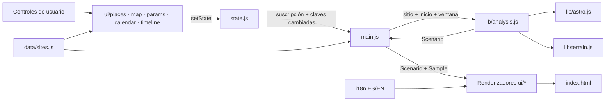
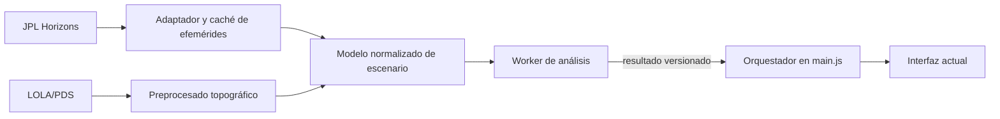

# Arquitectura de SELENE

Este documento describe la implementación actual de `web/`. El código es la fuente de verdad; la integración de LOLA y el consumo de efemérides Horizons en el análisis indicados aquí son propuestas y todavía no están implementados. El adaptador Horizons y su adquisición sí existen (DEC-020), pero `analysis.js` aún no los usa.

## Vista general

SELENE es una aplicación de una sola página construida con Vite y JavaScript ES modules, sin framework. `src/main.js` coordina un estado global mínimo, el motor científico síncrono de `src/lib/` y los renderizadores imperativos de `src/ui/`.

## Responsabilidades

| Módulo | Responsabilidad actual |
| --- | --- |
| `src/main.js` | Inicializa la aplicación, mantiene la caché del escenario, decide qué recalcular y coordina renderizados completos o instantáneos. |
| `src/state.js` | Conserva el estado mutable único y notifica un `Set` de claves cambiadas a los suscriptores. |
| `src/lib/astro.js` | Modelo periódico aproximado del punto subsolar y subterrestre; transforma posiciones selenográficas en azimut/elevación local y calcula la fase terrestre. |
| `src/lib/terrain.js` | Genera un horizonte sintético determinista, estima relieve para sitios no curados y calcula la depresión geométrica por altura. |
| `src/lib/analysis.js` | Muestrea Sol/Tierra cada 10 minutos, aplica horizonte y radios angulares, calcula ventanas, métricas, viabilidad y mapas de calor. |
| `src/lib/format.js` | Formatea ángulos, coordenadas, porcentajes, fechas UTC y duraciones para la interfaz. |
| `src/lib/horizons.js` | Adaptador puro de JPL Horizons (DEC-020): valida peticiones, arma la consulta y la clave de caché, interpreta y valida tablas `OBSERVER` y produce series normalizadas con fuente, marco, unidades y cobertura. Sin red ni DOM; todavía no lo consume `analysis.js`. |
| `scripts/fetch-horizons.mjs` | Script Node, fuera del bundle: consulta la API, guarda crudo + SHA-256 + serie normalizada en una caché con manifiesto. |
| `src/lib/coordinates.js` | Referencia común de los sitios (`SITE_REFERENCE`), normalización de longitud a `[-180°, 180°)`, validación de latitud y resolución nominal de las cifras. |
| `src/data/sites.js` | Catálogo de sitios curados en MOON_ME/DE421 con tipo de punto, procedencia, confianza y precisión (DEC-019); `relief` y `elevationKm` son sintéticos. |
| `src/i18n/` | Diccionarios ES/EN, idioma persistido y traducción del DOM. |
| `src/ui/places.js` | "Mejores lugares para alunizar": ranking de sitios para la ventana elegida. |
| `src/ui/map.js` | Mapa con las pestañas GLOBAL / MAPA DE CALOR / POLO SUR (imágenes del Figma), selección de coordenadas y alta de sitios. |
| `src/ui/params.js` | "Parámetros de la misión": sitio, coordenadas, duración y tarjetas de "Ventana de análisis". |
| `src/ui/calendar.js` | Selector de rango de fechas de "Duración de misión (UTC)". |
| `src/ui/panorama.js` | Panorama del sitio (ilustración del Figma) con Sol y Tierra ubicados por el modelo. |
| `src/ui/timeline.js` | Línea de tiempo de la misión: reproducción, velocidad y deslizador. |
| `src/ui/status.js` | Tarjetas "Energía solar" y "Comunicación" y "Lectura del momento". |

## Estado, cálculo y renderizado

1. Un controlador de `ui/` llama a `setState(patch)`.
2. `state.js` muta solo valores distintos y entrega al suscriptor las claves cambiadas.
3. Si cambia `siteId`, `lat`, `lon`, `startMs` o `windowDays`, `main.js` invalida su clave de escenario y ejecuta `computeScenario()`.
4. El escenario precalcula la ventana seleccionada y 32 días adicionales para localizar el siguiente cambio de visibilidad.
5. `sampleAt()` interpola el instante actual. Los azimuts usan interpolación circular para no saltar entre 359° y 0°.
6. Durante la reproducción se actualizan panorama y línea de tiempo en cada cuadro; los paneles textuales se limitan aproximadamente a ocho actualizaciones por segundo.
7. Los cambios de mapa, reproducción o idioma actualizan únicamente sus consumidores principales.

`computeScenario()` es síncrono y puede ser costoso. `computePolarHeatmap()` sigue en `lib/analysis.js` (cubierto por las pruebas), pero la interfaz actual no lo usa: la pestaña MAPA DE CALOR muestra la imagen del Figma (DEC-014, DEC-016).

## Contratos públicos

Las unidades son parte del contrato. No deben cambiarse sin acuerdo del equipo y adaptación de todos los consumidores.

### `lib/astro.js`

| Firma | Entrada | Salida |
| --- | --- | --- |
| `wrap180(deg)` | grados | grados normalizados en `[-180, 180)` |
| `wrap360(deg)` | grados | grados normalizados en `[0, 360)` |
| `subSolarPoint(ms)` | milisegundos Unix UTC | `{lat, lon}` en grados selenográficos, este positivo |
| `subEarthPoint(ms)` | milisegundos Unix UTC | `{lat, lon}` en grados selenográficos, este positivo |
| `skyPosition(site, sub)` | `{lat, lon}` y punto subyacente, grados | `{elevation, azimuth}` en grados; azimut desde norte en sentido horario |
| `sunPosition(site, ms)` | sitio + milisegundos Unix UTC | posición local del Sol |
| `earthPosition(site, ms)` | sitio + milisegundos Unix UTC | posición local de la Tierra |
| `earthPhase(ms)` | milisegundos Unix UTC | fracción iluminada en `[0,1]` |

Constantes públicas: `DAY_MS`, `SYNODIC_MONTH`, `ANOMALISTIC_MONTH`, `DRACONIC_MONTH`, `ECLIPSE_YEAR`, `SUN_RADIUS` y `EARTH_RADIUS`.

### `lib/terrain.js`

| Firma | Entrada | Salida |
| --- | --- | --- |
| `estimateRelief(lat, lon)` | grados selenográficos | relieve sintético característico en grados |
| `horizonDip(elevationKm = 0)` | km sobre terreno vecino | depresión angular positiva en grados |
| `createHorizon(site, options?)` | sitio; `precompute` opcional | función `horizon(azimuthDeg) -> elevationDeg` |

### `lib/analysis.js`

| Firma | Entrada | Salida |
| --- | --- | --- |
| `computeScenario(site, startMs, windowDays)` | sitio, Unix ms UTC, días | `Scenario` con series tipadas, horizonte, resumen y viabilidad |
| `sampleAt(scenario, ms)` | escenario e instante Unix ms UTC | muestra interpolada con estados de Sol/Tierra y acumulados |
| `computePolarHeatmap(options)` | inicio, días, `sun|earth`, tamaño y latitud mínima | `{values: Float32Array, size, minLat}`; fracciones `[0,1]`, `-1` fuera del disco |

`Scenario.summary.illumination` y `.communication` son porcentajes `[0,100]`; `.power` es una razón adimensional; tiempos de ventanas son Unix ms UTC; `.sunMinutes` y `.linkMinutes` son minutos. `STEP_MINUTES` vale actualmente 10.

### `lib/horizons.js` (DEC-020)

| Firma | Entrada | Salida |
| --- | --- | --- |
| `normalizeRequest(input)` | `{target: "sun"\|"earth", site: {lat, lon, altitudeKm, altitudeBasis, id?}, startMs, stopMs, stepMinutes}` | petición congelada con `command` y `expectedRows`; `HorizonsError` si es inválida |
| `buildQueryParams(req)` / `buildQueryUrl(req)` | petición | pares `[clave, valor]` en orden fijo / URL de la API (no la ejecuta) |
| `cacheKey(req, meta?)` | petición; fuente/versiones opcionales | texto canónico `src=…\|api=…\|profile=…\|…` |
| `unwrapApiResponse(body)` | texto JSON u objeto de la API | `{result, apiVersion}` o `HorizonsError` (`api-error`, `invalid-envelope`) |
| `parseObserverTable(result)` | texto `result` | `{meta, columns, samples, missing}` |
| `normalizeHorizons(body, req, retrieval?)` | cuerpo crudo, petición, metadatos de adquisición | serie `selene.horizons.observer/1` (`source`, `profile`, `request`, `frame`, `units`, `coverage`, `samples`, `assumptions`, `warnings`) |
| `jdToUnixMs(jdText)` / `formatHorizonsTime(ms)` | JD en texto / Unix ms | Unix ms UTC / `YYYY-MM-DD HH:MM` UTC |

`samples` contiene arreglos paralelos (`timeMs`, `jdUt`, `azimuthDeg`, `elevationDeg`, `illuminatedPct`, `angularDiameterArcsec`, `solarPresence`, `interfererPresence`); los faltantes son `null`. Los errores son `HorizonsError` con `code` estable (`invalid-site`, `missing-altitude`, `no-ephemeris`, `unexpected-columns`, `out-of-range`, `coverage-mismatch`, `site-mismatch`, …).

### `state.js`

- `getState() -> State`: devuelve la referencia del estado actual; los consumidores no deben mutarla directamente.
- `setState(patch)`: aplica un parche superficial y notifica solo si cambió algún valor por igualdad estricta.
- `subscribe(fn) -> unsubscribe`: `fn(state, changedKeys)` recibe el estado y un `Set<string>`.

## Dependencias internas

- `analysis.js` depende de `astro.js` y `terrain.js`; ninguno depende de la interfaz.
- `horizons.js` depende solo de `coordinates.js`. No hace red: la red vive en `scripts/fetch-horizons.mjs`, que se ejecuta con Node antes de la demo.
- `main.js` es el único coordinador entre análisis y renderizado.
- Los módulos `ui/` pueden leer/escribir estado, formatear e internacionalizar, pero no deben implementar fórmulas científicas.
- `map.js` es la excepción de coordinación que invoca el cálculo público del mapa de calor; el cálculo permanece en `lib/analysis.js`.
- No existen dependencias de ejecución aparte del navegador; Vite es dependencia de desarrollo.

## Evolución hacia datos reales

### Efemérides con JPL Horizons

El adaptador (`lib/horizons.js`) y la adquisición con caché (`scripts/fetch-horizons.mjs`) ya cumplen los puntos 1, 3, 4 y 5 y la parte de caché del 2 (DEC-020). Falta que CORE-01 cargue las series en el análisis manteniendo el contrato conceptual de `sunPosition()` y `earthPosition()`: azimut y elevación locales en grados para sitio e instante. Requisitos del adaptador:

1. normalizar sitio, intervalo, paso, escala temporal y sistema de referencia;
2. consultar o leer una caché fuera de los bucles de renderizado y muestreo;
3. validar y convertir la respuesta a una serie local explícitamente versionada;
4. entregar errores y datos faltantes como estados representables, no como ceros;
5. conservar metadatos de fuente, consulta, cobertura y calidad.

### Topografía con LOLA

Un proceso de preparación debe obtener el producto PDS/LOLA elegido, documentar su referencia y resolución, extraer un DEM alrededor del sitio y calcular el ángulo máximo de obstrucción por azimut incluyendo curvatura lunar. El resultado puede implementar el contrato `horizon(azimuthDeg) -> elevationDeg`, acompañado de metadatos y cobertura. No debe descargarse topografía dentro de `computeScenario()`.

### Arquitectura futura propuesta

| Actual | Futuro propuesto |
| --- | --- |
| Cálculo periódico local y síncrono | Series de efemérides reales obtenidas antes del análisis |
| Horizonte sintético por ondas | Perfil derivado de DEM LOLA con procedencia |
| Resultados sin metadatos de calidad | Resultado + fuente + cobertura + calidad + versión |
| Recalculo en hilo principal | Carga asíncrona y análisis intensivo en Web Worker |
| Suposición de disponibilidad total | Estados `loading`, `ready`, `unavailable`, `error` y resultado anterior controlado |

## Operaciones asíncronas sin romper la interfaz

- Mantener separados `State`, `ScenarioRequest` y `ScenarioResult`; asociar cada respuesta a una clave o identificador para descartar respuestas obsoletas.
- Conservar el último resultado válido mientras llega uno nuevo, marcado visualmente como desactualizado, o mostrar un estado de carga explícito.
- Cancelar solicitudes reemplazadas mediante `AbortController` cuando corresponda.
- Cachear por sitio normalizado, intervalo, paso, fuente y versión del modelo.
- Mover cálculo intensivo a un Web Worker; enviar estructuras serializables o buffers transferibles.
- No hacer peticiones de red desde `requestAnimationFrame`, `sampleAt()`, bucles temporales ni celdas del mapa de calor.
- Tratar ausencia parcial de datos como tal y propagarla hasta la UI; no interpolar fuera de cobertura sin una política documentada.

